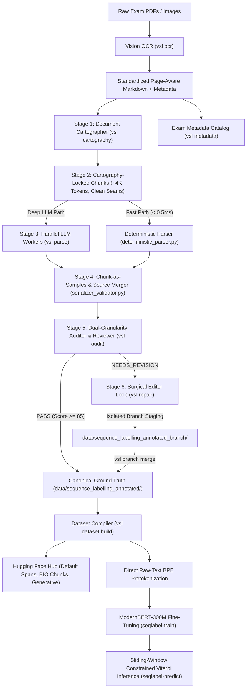

# Vietnamese Sequence Labelling v2

Vietnamese examination-document processing engine and neural sequence-labelling framework for autonomous OCR ingestion, spatial document cartography, character-preserving XML annotation, deterministic auditing, LLM semantic review, surgical XML repair, and sub-millisecond transformer inference.

The project is built specifically for Vietnamese national high school examinations (TN THPT, GDPT 2018), cloze tests, reading passages, multiple-choice questions, true/false propositional items, short answers, figures, tables, and multi-page reading stimuli. It guarantees 100% character fidelity against the raw source text while annotating structural spans (`<question_label>`, `<stem>`, `<option_label>`, `<option_text>`, `<stimulus>`, `<section>`, `<explanation>`, `<figure>`).

---

## Architecture Pipeline



---

## Requirements & Setup

- **Python**: 3.10 or newer
- **Package Manager**: [`uv`](https://docs.astral.sh/uv/)
- **Hardware**: CPU supported for OCR/parsing/deterministic audits; GPU (NVIDIA T4 / V100 / A100 / H100) required for neural transformer training.

### 1. Installation

```bash
# Clone the repository
git clone https://github.com/daominhwysi/super-dollop.git
cd super-dollop

# Install core dependencies (CLI, OCR, parsers, APIs)
uv sync

# (Optional) Install neural training & evaluation dependencies (PyTorch, Transformers, Accelerate, MLflow)
uv sync --extra train
```

### 2. Environment Configuration

Create a local `.env` file in the project root:

```dotenv
OPENAI_API_KEY=your_key_here

# Optional Provider Credentials
DEEPSEEK_API_KEY=your_key_here
XAH_API_KEY=your_key_here
NVIDIA_API_KEY=your_key_here

# Optional Remote MLflow / DagsHub Tracking
MLFLOW_TRACKING_USERNAME=your_username
MLFLOW_TRACKING_PASSWORD=your_token
```

Verify resolved paths:

```bash
uv run vsl paths
```

---

## CLI Entrypoints Reference

The toolkit installs five dedicated console scripts defined in [`pyproject.toml`](pyproject.toml):

| Command | Entrypoint | Description |
|---|---|---|
| `vsl` / `sequence-label` | `sequence_labelling.cli:main` | **Unified operational CLI** covering the entire dataset, parsing, audit, repair, and monitoring lifecycle. |
| `synthetic-exam-gen` | `synthetic_exam_generator.cli:main` | Synthesizes curriculum-grounded Vietnamese examinations across difficulty tiers. |
| `seqlabel-train` | `model.train:main` | Distributed fine-tuning of `aisingapore/SEA-LION-ModernBERT-300M` with `LengthGroupedBatchSampler`. |
| `seqlabel-predict` | `model.inference.predict:main` | High-throughput sliding-window inference with Constrained Viterbi BIO decoding. |
| `seqlabel-export` | `model.export:main` | Exports trained models to ONNX and deployable checkpoint bundles. |

---

## End-to-End Operational Workflow (`vsl` CLI)

Check the live status of all pipeline components anytime:

```bash
uv run vsl status
```

### 1. Vision OCR Ingestion

Converts raw examination PDFs and images into standardized, page-aware Markdown with automatic rate-limit recovery:

```bash
uv run vsl ocr \
  --raw-dir data/sequence_labelling_input_data_raw \
  --out-dir data/sequence_labelling_input_data \
  --concurrency 2
```

### 2. Document Cartography & Metadata Catalog

Scans document layout top-to-bottom to extract topological page boundaries and catalog subject, grade, and year:

```bash
# Generate spatial cartography manifests (clean-cut seams, stimuli spans, question ranges)
uv run vsl cartography \
  --input-dir data/sequence_labelling_input_data \
  --out-dir data/document_cartography \
  --model gpt-6-luna

# Extract structured exam metadata catalog
uv run vsl metadata \
  --input-dir data/sequence_labelling_input_data \
  --out-file data/dataset_metadata_catalog.json
```

### 3. Cartography-Locked Annotation (`parse`)

Runs parallel LLM parser workers on cartography-locked chunks (~4K tokens):

```bash
uv run vsl parse \
  --raw-dir data/sequence_labelling_input_data \
  --annotated-dir data/sequence_labelling_annotated \
  --provider agy \
  --model gemini-3.8-flash \
  --concurrency 4
```

### 4. Quality Audit (`audit`)

Performs dual-granularity deterministic and LLM semantic quality auditing:

```bash
# Document or chunk level audit with semantic review
uv run vsl audit \
  --annotated-dir data/sequence_labelling_annotated \
  --raw-dir data/sequence_labelling_input_data \
  --granularity chunk \
  --provider codex \
  --model gpt-5.6-luna \
  --thinking high \
  --out-report data/review_report.json

# Fast deterministic-only audit (<0.5ms per chunk, no LLM cost)
uv run vsl audit \
  --annotated-dir data/sequence_labelling_annotated \
  --raw-dir data/sequence_labelling_input_data \
  --no-llm
```

### 5. Surgical Repair Loop (`repair`)

Executes multi-round surgical search-and-replace repairs on `NEEDS_REVISION` documents. **All edits stage strictly in an isolated branch directory**:

```bash
uv run vsl repair \
  --report data/review_report.json \
  --filter needs_revision \
  --concurrency 4 \
  --granularity chunk \
  --branch-dir data/sequence_labelling_annotated_branch \
  --out-report artifacts/reports/revision_resolution_report.json
```

- **Unambiguous Patching**: `SearchReplacePatcher` rejects search blocks with `count > 1` to prevent misaligned edits.
- **Cache Invalidation**: Chunks are re-parsed automatically if cartography boundaries or raw text changed.

### 6. Merge Approved Branch Candidates (`branch merge`)

Verifies character fidelity (`strip_tags(candidate) == strip_tags(original)`), valid XML syntax, and minimum score threshold before promoting branch candidates into the canonical dataset:

```bash
uv run vsl branch merge \
  --branch-dir data/sequence_labelling_annotated_branch \
  --target-dir data/sequence_labelling_annotated \
  --min-score 60.0
```

### 7. Compile Dataset Splits & Publish (`dataset build`)

Compiles verified annotations into token classification, character span, and generative instruction splits:

```bash
uv run vsl dataset build \
  --output-dir data/dataset_training_splits \
  --synthetic-ratio 0.4 \
  --train-ratio 0.8 \
  --val-ratio 0.1 \
  --test-ratio 0.1
```

- **Direct BPE Pretokenization**: Uses `attach_pretokenization` to align raw subwords directly with character offsets, guaranteeing 100% token parity between training and inference.
- **Multi-Config Hugging Face Export**: Publishes three distinct subsets via [`tools/dataset/upload_dataset_to_hf.py`](tools/dataset/upload_dataset_to_hf.py):
  1. `default`: Document-level character spans.
  2. `bio_chunks`: Multi-scale sliding-window BIO chunks.
  3. `generative`: Structured question-answering instruction pairs.

### 8. Benchmark Evaluation (`evaluate`)

```bash
# Evaluate against 63 Gold Benchmark documents
uv run vsl evaluate gold --gold-manifest data/gold_benchmark_63_documents.json

# Evaluate Deterministic Parser F1 accuracy
uv run vsl evaluate det-f1

# Evaluate full 500-document corpus invariants
uv run vsl evaluate corpus-500
```

---

## Native Detached TMUX Orchestration

Any `vsl` operational command can run as an independent background session by appending `--tmux [SESSION_NAME]`:

```bash
# Launch a 4-worker repair job in background TMUX
uv run vsl repair --tmux vsl-repair-batch --concurrency 4

# Inspect active sessions
uv run vsl tmux list

# Tail live output logs
uv run vsl tmux logs vsl-repair-batch

# Attach interactively
uv run vsl tmux attach vsl-repair-batch

# Terminate session
uv run vsl tmux kill vsl-repair-batch
```

---

## Neural Model Architecture & Training

### Backbone: `aisingapore/SEA-LION-ModernBERT-300M`

- **Context Window**: 8,192 tokens (configured to 2,048 for sliding windows).
- **Attention**: PyTorch Native SDPA (`attn_implementation: "sdpa"`), RoPE, and Unpad token packing.
- **Enhanced Classification Head (`model/module/head.py`)**:
  - `SigmoidWeightedLayerPooling`: 4-layer sigmoid-gated layer pooling replacing competing softmax.
  - 1D Depthwise Convolutional Refinement (`kernel_size=7`).
  - Tightened Multi-Sample Dropout (MSD): 5 branches with rates `[0.05, 0.10, 0.15, 0.20, 0.25]`.
  - `per_branch_focal_loss: true`: Evaluates Focal Loss ($\gamma=2.0$, smoothed inverse frequency $\alpha$) per branch prior to ensemble averaging.
- **Efficient Batching**: `LengthGroupedBatchSampler` buckets sequences of similar length (512, 768, 1024, 2048) by 64-token intervals to eliminate GPU pad-token waste.

### Launch Distributed Training

```bash
uv run seqlabel-train \
  --config configs/train_config.yaml
```

Track training metrics in real-time with local MLflow:

```bash
uv run mlflow ui
```

---

## Synthetic Exam Generation & Data Augmentation

Configuration resides in [`configs/augmentation_config.yaml`](configs/augmentation_config.yaml):

- **Curriculum Synthesis**: Generates diverse question stems and distractors across high-school subjects (Math, Physics, Chemistry, Biology, History, Geography, GDCD, KHTN).
- **Layout Permutations**: Horizontal inline choices (`A. ... B. ...`), 2x2 grids, and barem variations.
- **Paired Real Whitespace Augmentation**: Prevents noise compounding on scanned documents by keeping 100% of real docs pristine while generating paired whitespace-augmented clones for 25% of training records.
- **Adversarial Hard Negatives**: Spliced definitions, formula cards, and outlines injected as background `'O'` tokens to minimize false-positive question detection.

Generate synthetic curriculum sets:

```bash
uv run synthetic-exam-gen \
  --output-dir data/synthetic_exams \
  --count 100 \
  --subject toan
```

---

## Annotation Contract & Tag Specifications

Recognized sequence labeling XML tags:

```xml
<section>Phần I. Câu trắc nghiệm nhiều phương án lựa chọn</section>
<stimulus id="stim_1" start_anchor="Dựa vào thông tin" end_anchor="trả lời các câu hỏi sau." />
<question_label>## Câu 1.</question_label>
<stem>Cho hàm số bậc ba $y = f(x)$ có đồ thị như hình vẽ...</stem>
<option_label>A.</option_label> <option_text>$y = 1$</option_text>
<option_label>B.</option_label> <option_text>$y = -1$</option_text>
<option_label>C.</option_label> <option_text>$y = 2$</option_text>
<option_label>D.</option_label> <option_text>$y = 0$</option_text>
<explanation>Lời giải chi tiết: Ta có đạo hàm...</explanation>
<figure id="fig_1" description="Đồ thị hàm số bậc ba" />
```

### Core Tagging Invariants

1. **Stemless Cloze / Fill-in Questions**:
   `<question_label>` does **not** require a following `<stem>`. Questions indexing passage blanks (e.g. `<question_label>Câu 631</question_label> <option_label>A.</option_label>...`) are 100% valid.
2. **Heading Marker Preservation**:
   Markdown heading markers immediately preceding question labels belong inside the tag: `<question_label>## Câu 1.</question_label>`.
3. **Sentence Arrangement Exception**:
   In sentence/paragraph rearrangement items, sentences labeled `a., b., c., d.` belong inside `<stem>`, while `A., B., C., D.` are tagged as `<option_label>`.
4. **Section-Bounded Stimuli**:
   Intervening `<section>` dividers terminate preceding `<stimulus>` context, preventing stimulus leakage into subsequent exam parts.
5. **Character Identity Invariant**:
   `strip_tags(annotated_xml) == raw_ocr_text` must hold with 100% character precision.

---

## HTTP Services (FastAPI Worker API)

Launch the background worker service:

```bash
PYTHONPATH=. uv run uvicorn sequence_labelling.api:app \
  --host 0.0.0.0 \
  --port 8100
```

### Endpoints

| Method | Endpoint | Purpose |
|---|---|---|
| `GET` | `/v1/health` | Health check and worker readiness |
| `POST` | `/v1/jobs` | Submit PDF/image upload or raw text sequence labelling job |
| `GET` | `/v1/jobs` | List active in-memory jobs |
| `GET` | `/v1/jobs/{job_id}` | Inspect job progress and output XML/JSON |
| `DELETE` | `/v1/jobs/{job_id}` | Cancel/delete an in-memory job |
| `POST` | `/v1/answer-keys/map` | Extract and map answer keys to structured question IDs |
| `POST` | `/v1/chat/completions` | OpenAI-compatible LLM proxy endpoint |

---

## Testing & Quality Assurance

Run the comprehensive unit test suite:

```bash
UV_CACHE_DIR=/tmp/vsl-uv-cache uv run pytest tests/unit/ -q
```

Run source merger and chunk provenance integration tests:

```bash
UV_CACHE_DIR=/tmp/vsl-uv-cache uv run pytest tests/test_merger/ -q
```

The test suites validate OCR helpers, XML checkers/cleaners, deterministic auditing, boundary seam reconcilers, multi-scale sliding windows, classification heads, Viterbi decoders, and unified CLI operations.

---

## Directory Data Invariant

- `data/` and `artifacts/ocr_logs/` are local runtime directories and are gitignored.
- All candidate edits and re-annotations stage in `data/sequence_labelling_annotated_branch/`.
- All research reports and benchmark evaluations reside in `artifacts/reports/`.

---

## License

See [`LICENSE`](LICENSE).
